# BOREO Superkikko2 Torch Mount — DIY 3D-printable prototype

A two-piece DIY torch-mount prototype designed around one measured **Petzl BOREO M/L helmet** and the existing **Superkikko2 metal butterfly plate and U-bracket**. Includes separate **STL**, editable **STEP/CAD sources** and a prepared **3MF** printing project. A curved inner bridge passes through the existing ventilation slots and bolts to an external backing plate, without drilling, glue or an elastic band around the helmet.

**Development version 0.1.0. Ready for printing as a prototype in the documented setup. The user confirms that the photographs show the latest model printed in PLA and installed on the helmet. The prepared PETG job has not been physically verified; final lamp fastening, measured fit, load retention and heat performance remain open.** This independent experimental design is not an approved Petzl accessory or validated protective equipment. The public project identity is **BOREO Superkikko2 Torch Mount**. No tagged GitHub release is published yet.

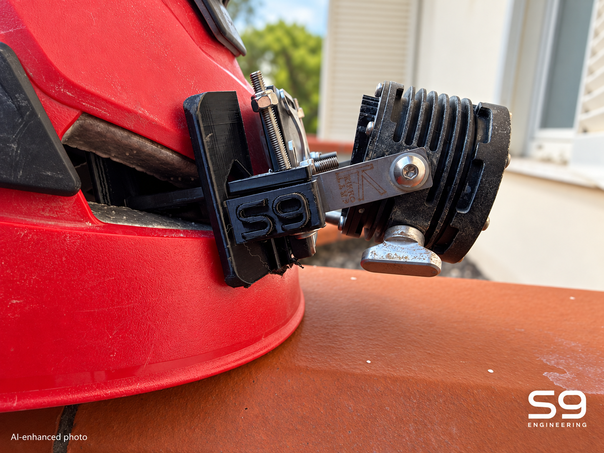

*AI-enhanced photo based on the supplied side photograph: restrained lighting/background treatment and full S9 Engineering signature at bottom-right. Trial hardware and visible print imperfections are retained. See the unchanged-scene photographs below for reference.*

## Real-print photographs

User-supplied photographs added on **27 October 2026**. The six views below have only orientation, format and web-size conversion; no generative alteration. Click each photograph for its full-resolution public copy.

| Side mounting detail | Metal butterfly and backing | Underside and helmet rim |
| --- | --- | --- |
| [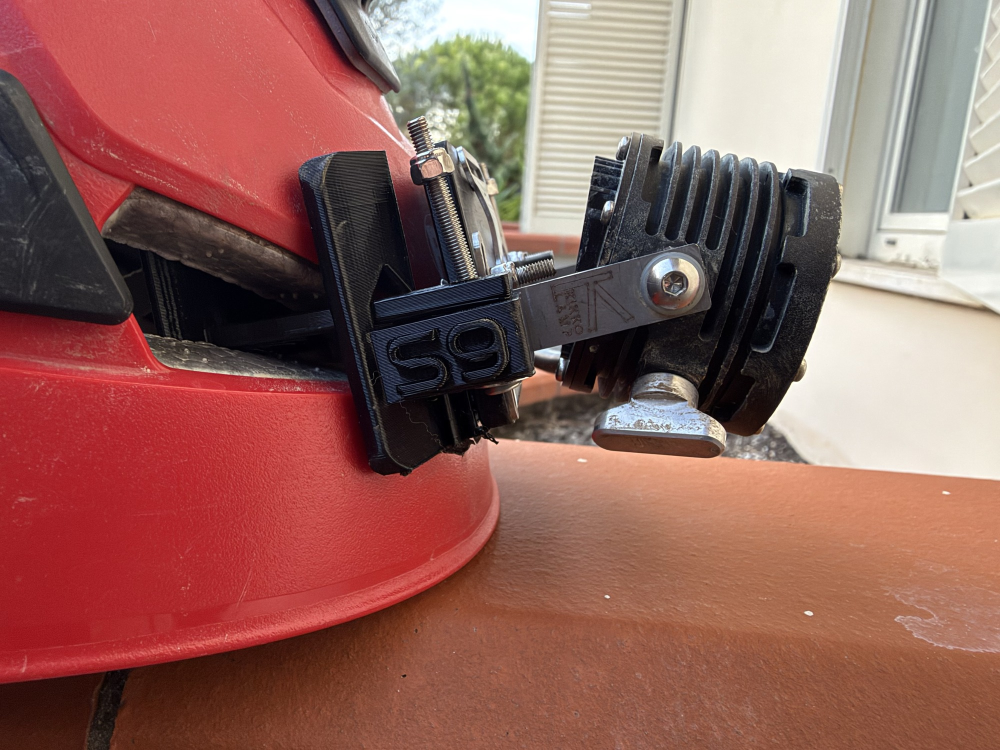](previews/photos/edited/mount-side-real.jpg) | [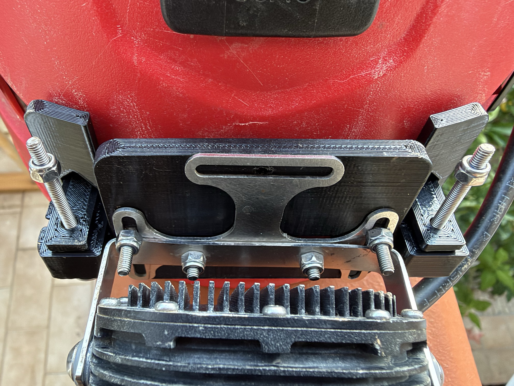](previews/photos/edited/butterfly-backing-real.jpg) | [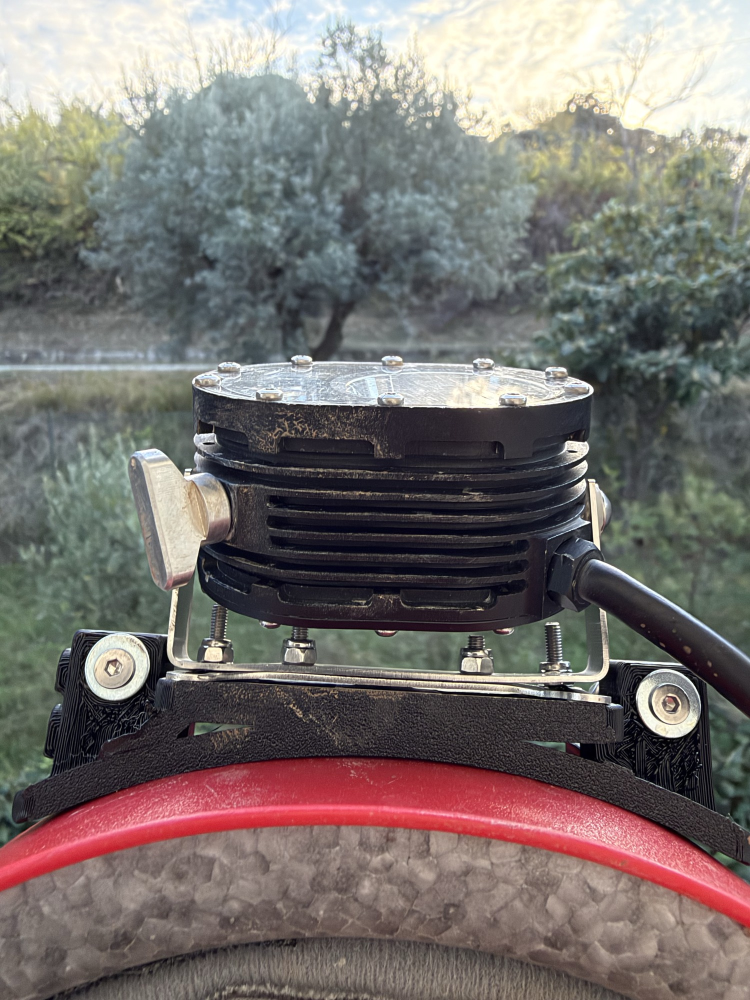](previews/photos/edited/mount-underside-real.jpg) |
| Continuous inner bridge | Opposite side and cable | Mounted lamp overview |
| [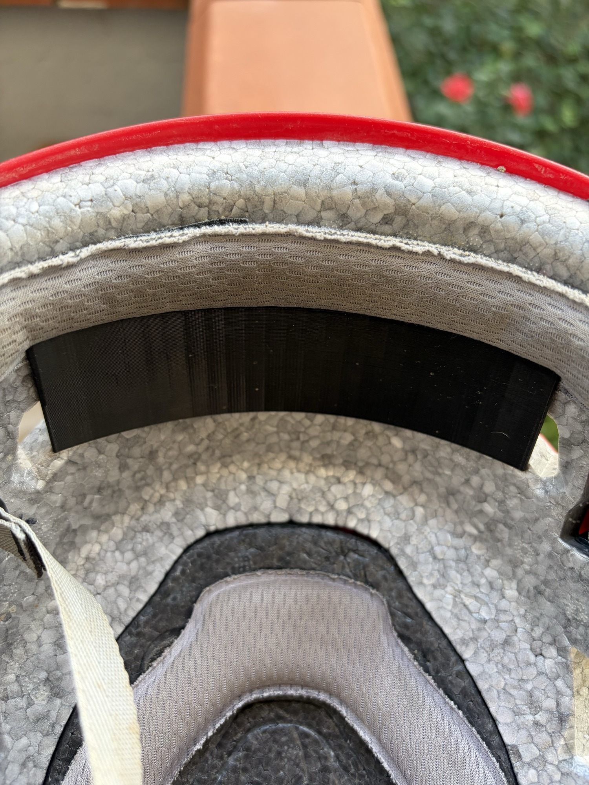](previews/photos/edited/inner-bridge-real.jpg) | [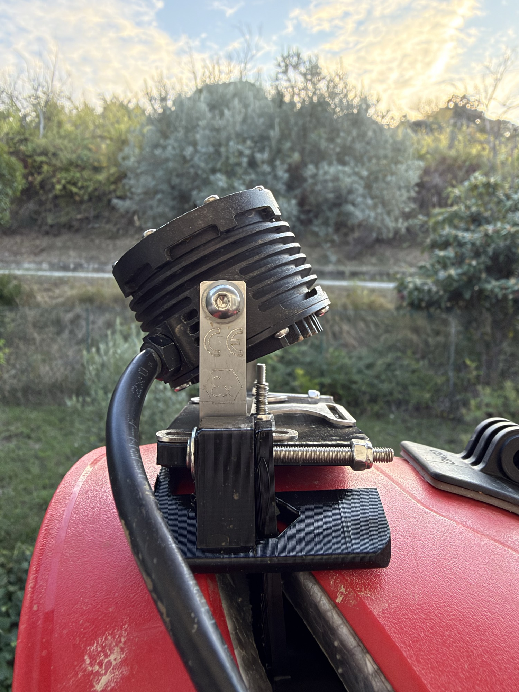](previews/photos/edited/lamp-side-real.jpg) | [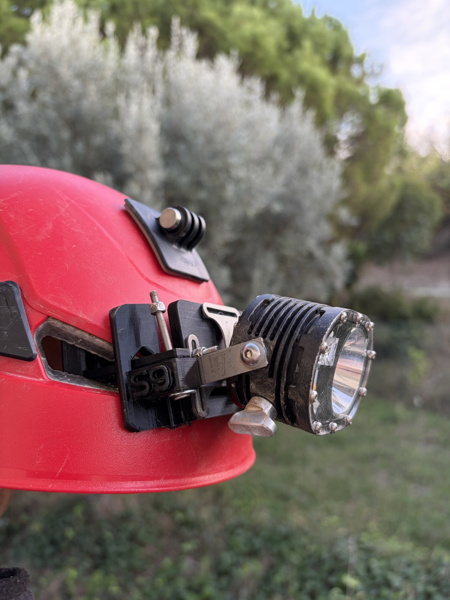](previews/photos/edited/helmet-mounted-real.jpg) |

The photographs document a **physical printed trial assembly**, not a load or thermal test. The upper butterfly slot is visibly unfastened and long trial bolts protrude; their size is not inferred from the pictures and they are not the specified final hardware. Support-contact residue and layer lines remain visible. The user confirms the latest model was printed in PLA. Its actual machine settings were not supplied; the prepared PETG profile is a separate, digitally checked setup. [Photo provenance and privacy checks](previews/photos/README.md).

## CAD views

| External plate and joint | Inner curved bridge | Underside reinforcement |
| --- | --- | --- |
| 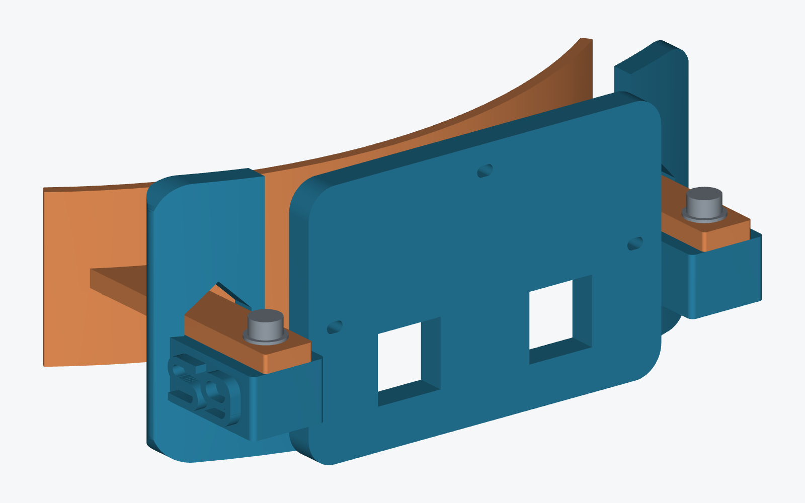 | 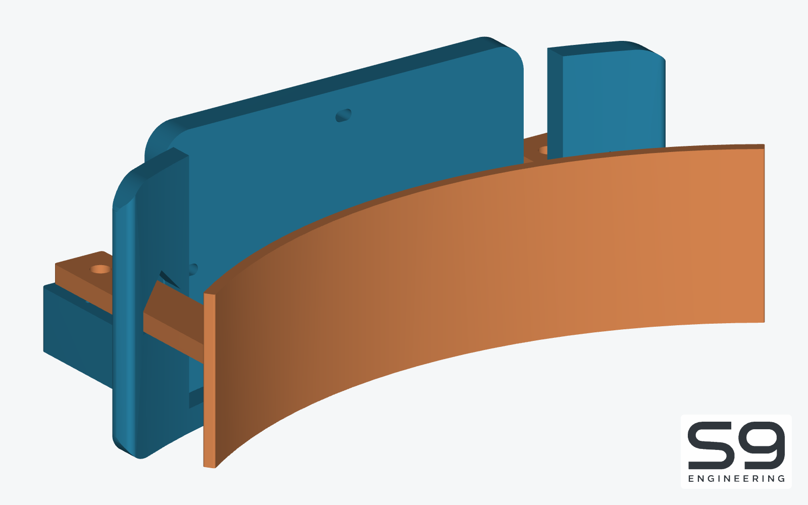 | 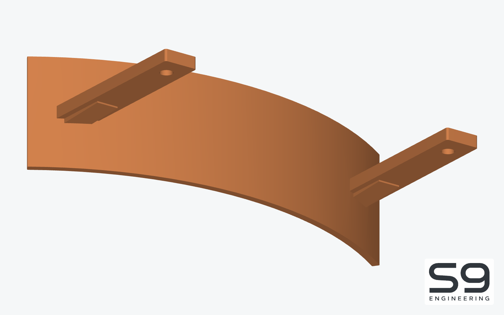 |

*CAD renders. Colours identify parts; the bundled job uses one filament. Grey hardware is purchased, not printed. These illustrate the downloadable model; the photographs show the user's PLA trial of that model.*

## What you need

### Printing materials and parts

PETG suitable for your calibrated process, enough for two parts and removable supports. The prepared job estimates **44.23 g** in **My setup**; allow extra for loading and trials. The photographed fit trial uses PLA; the prepared job uses PETG.

| Part | Quantity | Print-oriented STL | Overall dimensions, mm |
| --- | --- | --- | --- |
| Centred inner bridge with external ribs | 1 | [inner-bridge.stl](print/stl/inner-bridge.stl) | 104.98 × 50.05 × 28.80 |
| Rounded backing plate with S9 relief | 1 | [backing-plate.stl](print/stl/backing-plate.stl) | 102.80 × 25.61 × 46.00 |

The inner skin is **2 mm** thick and **28.8 mm** high with centred arms. Arms are **9.2 × 3.2 mm**; ribs bring the nominal local envelope to **4.4 mm**. The backing retains three fastening passages, two rivet reliefs, rounded edges and a **2 mm raised S9 logo**. These are design dimensions, not measurements of a finished print.

### Assembly BOM and Amazon.it examples

Listings checked **27 October 2026**. Non-affiliate sourcing examples, not mandatory brands; written specifications govern equivalents. No purchase was made. Prices and delivery promises are omitted. Listing verification does not inspect delivered hardware.

| Item | Required quantity | Specification / fit constraint | Amazon example and pack |
| --- | --- | --- | --- |
| Bridge/base screws | 2 | M3 × 16 mm, full thread, cylindrical socket head, ISO 4762 / DIN 912, stainless A2; CAD head Ø5.5 × 3 mm | [ProRaje M3 × 16, 10 screws](https://www.amazon.it/dp/B0DHPJTV8P); one 10-piece pack |
| Self-locking nuts | 2 | M3 nylon insert, DIN 985; target AF 5.5 / height 4 mm, for AF 5.85 / depth 4.3 mm pockets | [qjuwhua M3 nuts and washers](https://www.amazon.it/dp/B0GFC9H67Y); one pack contains 100 nuts and 100 washers, shared with the next row |
| Flat washers | 2 | M3 DIN 125; nominal ID 3.2 / OD 7 / thickness 0.5 mm | Same [nuts-and-washers pack](https://www.amazon.it/dp/B0GFC9H67Y); no second pack needed |
| PETG filament | About 45 g plus trial/loading allowance | Suitable PETG and its own profile; 1.75 mm for the prepared machine | [ELEGOO PETG black, 1 kg](https://www.amazon.it/dp/B0F443Q9KS), one spool if needed. **This is PETG, not a verified PETG Pro SKU: reslice the STL using its own profile** |
| Lamp interface | 1 | Original Superkikko2 butterfly plate and U-bracket with measured 2 mm slots | Reuse the matching original assembly; no replacement selected |
| Butterfly-to-base fasteners | Up to 3 sets, pending | M1.6 screw/washer/nut is only a candidate. Length and head/washer clearance require metal thickness and rivet measurements | **Not selected for purchase.** M3 does not fit the original 2 mm slots |
| Helmet | 1 | The measured BOREO M/L used for this project | Existing device; no wider fit claim |

The nut/washer listing identifies the required standards but does not independently confirm every dimension. Check actual nut height/AF and washer dimensions before assembly. Relevant tools are a 2.5 mm hex key and 5.5 mm spanner for the defined joint, plus a caliper and small support-removal tool. Confirm the actual screw drive. No general tool kit is specified.

## Downloads and print files

Canonical download entry point: [BOREO Superkikko2 Torch Mount — Releases](https://github.com/S9-Engineering/boreo-superkikko2-torch-mount/releases). **No tagged GitHub release is published yet.** The linked repository pack is an **unreleased development prototype**, not a stable public release.

- [Current prototype print pack](packages/boreo-superkikko2-torch-mount-print-pack.zip): two STL files, native 3MF, standalone English guide, assembly image and licence notices; no CAD, scripts, logs or historical revisions.
- [Native slicer project](print/slicer/boreo-superkikko2-petg.3mf): both parts on one plate, profiles, support settings and sliced path for **My setup**.
- [Verified setup-specific G-code](print/slicer/boreo-superkikko2-petg.gcode): only for the documented configuration; omitted from the new general print pack.
- [Geometry-only 3MF](print/slicer/geometry-only.3mf): geometry/placement without a complete printing configuration.
- Editable STEP: [bridge](cad/inner-bridge.step), [base](cad/backing-plate.step), [assembly](cad/assembly/assembly.step).
- [English printing and assembly guide](docs/printing.md).

For other printers/materials, import STL in **millimetres**, keep the documented orientation and slice with the appropriate machine/filament profile. Do not mix current and historical parts.

## My setup

This setup was **prepared and digitally checked**. The user confirms the photographed model was printed in PLA. Actual print settings were not supplied; the prepared PETG native job is not physically verified.

| Setting | Prepared configuration |
| --- | --- |
| Printer | ELEGOO Centauri Carbon 2 Combo; internal profile: Elegoo Centauri Carbon 2 0.4 nozzle |
| Nozzle / plate | 0.4 mm / textured PEI |
| Filament | ELEGOO PETG Pro, 1.75 mm; photographed PLA trial is black |
| Slicer | ElegooSlicer 1.5.3.5; CLI engine 2.4.2 |
| Temperatures | 240 °C nozzle / 65 °C plate; within the [manufacturer's PETG Pro range](https://www.elegoo.com/products/petg-pro-filament-1-75mm-colored-1kg) |
| Layers / walls / infill | 0.20 mm / 5 / 30% gyroid; 5 top/bottom layers |
| Flow limit / speeds | 5 mm³/s; outer/inner/infill/first-layer: 40/60/70/25 mm/s; bridges 25 mm/s |
| Supports | Normal snug, plate only; top/bottom Z gaps 0.40 mm, XY gap 0.55 mm, two interface layers at 0.5 mm spacing |
| Adhesion / material changes | No brim, skirt, raft or purge tower; one filament, printing by layer |
| Slicer estimate | **2 h 55 min 19 s / 44.23 g**, supports included; 230 layers |

Flow 0.98, pressure advance 0.1 and cooling are initial profile values, not new spool calibrations. Larger support gaps aim to reduce welded residue; a clean underside is not guaranteed. Use dry material and follow its manufacturer's drying guidance. [Profiles](source/profiles) and provenance are retained.

## How to

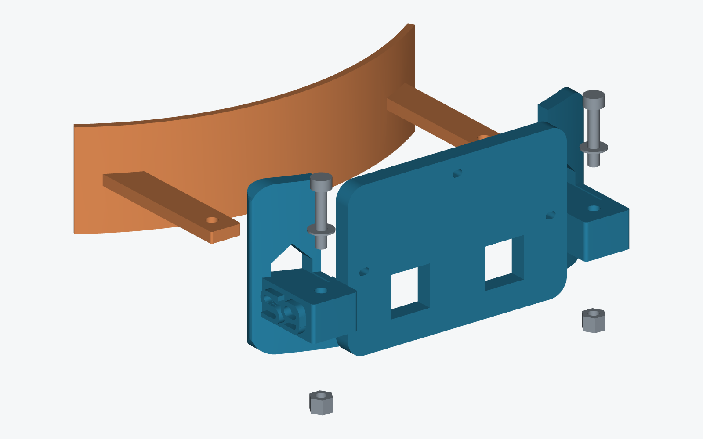

1. **Choose the matching package.** Until publication, use the linked prototype pack. After publication, open the [Releases page](https://github.com/S9-Engineering/boreo-superkikko2-torch-mount/releases), select the matching version/setup, expand **Assets**, download its named **print-pack.zip**, extract it and read the included README. GitHub's automatic source ZIP is different. Keep files from one version together.
2. **Choose a printing route.** Use the native 3MF only with the matching setup, or import both STL files and slice for your own configuration. Confirm units, quantity, orientation, supports and first layer before printing.
3. **Clean separate pieces.** Cool before removing support towers. Clear residue from pockets and passage surfaces. Preserve the tapered ribs beneath the arms: they are part of the model.
4. **Try the helmet fit first.** With the helmet stationary and not worn, insert without bending arms or compressing foam. Stop if the ribbed transition binds. Check padding/adjustment hardware in both bridge orientations; do not modify the helmet to accommodate it.
5. **Try the M3 joint.** Slide the base onto the arms, insert nuts from below, then washers and screws. Seat lightly for the dimensional trial. No validated working torque is specified; do not clamp the helmet foam.
6. **Check the butterfly with the lamp off and bench-supported.** Confirm slot alignment, rivet relief and tool/head clearance before choosing the three fastening sets. Do not widen the metal slots or use M3 in them. Printed passages are not self-tapping threads.
7. **Record results.** Insertion, lamp fastening, load/time retention and contact temperature still require physical checks. Full backing does not establish heat dissipation. Cold wet and submerged use remain unverified.

## Geometry and known fit limits

The M3 joint uses Ø3.4 mm holes: **0.4 mm diametral clearance**. Arm seats have **0.35 mm per-side clearance**. Nut pockets are 5.85 mm AF. Bridge outer radius 92 mm and arm axes ±42 mm are design assumptions around this specimen, not universal BOREO dimensions.

Butterfly interaxis **57.5 mm is estimated**, derived from approximately 63.5 mm overall photographed width and the user's confirmed 2 mm slots/borders. Upper-passage Z41.5, metal thickness and rivet projection remain provisional. [Bridge parameters](source/bridge-parameters.json) and [base parameters](source/base-parameters.json) are editable.

## Source and regeneration

[Editable sources](source) are self-contained. Necessary logos are project-local. Use **Python 3.11** and a project-local environment:

    python3.11 -m venv .venv
    .venv/bin/python -m pip install -r source/requirements.txt
    .venv/bin/python source/generate.py
    .venv/bin/python source/verify.py
    .venv/bin/python source/render.py
    .venv/bin/python source/slice.py
    .venv/bin/python source/verify_logo.py
    .venv/bin/python source/verify_package.py

Slicing requires the documented ElegooSlicer installation or `--slicer`. Review regenerated toolpaths before printing. Build the current prototype pack with `python3 source/build_print_pack.py`. Photo preparation uses the separate macOS dependencies documented in [Photo provenance](previews/photos/README.md).

## Verification

Retained evidence records **140 geometry checks, 110 package checks, 230 rendered/reviewed layers**, no slicer warnings and no candidate islands. Native 3MF geometry/poses match the exports, and embedded/separate G-code match. Photo preparation on 27 October independently rechecked current print-file hashes. Geometry, slicing and their historical reports were not changed.

- [Geometry](verification/geometry.json)
- [Slicing and layer review](verification/slicing/report.json)
- [Package checks](verification/package.json)
- [Original delivery status](verification/delivery.json)
- [Layout and integrity report](verification/repository-layout.json)
- [Real-print photo evidence and checks](verification/photos.json)

Earlier fit feedback concerns an orange coupon. The user identifies the new photographs as the latest model printed in PLA and mounted on the helmet. They do not provide a measured fit or a physical PETG test. Mesh-intersection screening is not a complete mathematical proof. No carrying capacity, safe operating temperature or protective compatibility is claimed. This preparation workflow did not start a printer.

## Versioning and licences

The single project version is [VERSION](VERSION), currently **0.1.0** (unreleased development). This working tree contains the current model only. Git commits preserve history; distributed versions use semantic tags `vMAJOR.MINOR.PATCH`. Legacy labels in frozen reports or embedded slicer profile IDs are provenance, not a second current version counter. Earlier snapshots and their original reports can be recovered from commit `54c08956b31ceaa43f58314ac0fea845e96dc9be`. No public tag or release asset was changed.

Original models/documentation: **CC BY-NC-SA 4.0** ([LICENSE.txt](LICENSE.txt)). Original S9 software: **PolyForm Noncommercial 1.0.0** ([LICENSE-SOFTWARE.txt](LICENSE-SOFTWARE.txt)), described as **source-available**. [LICENSING.md](LICENSING.md) defines scope, Required Notice, S9 branding and third-party exclusions. Device names identify intended compatibility without affiliation or approval.
