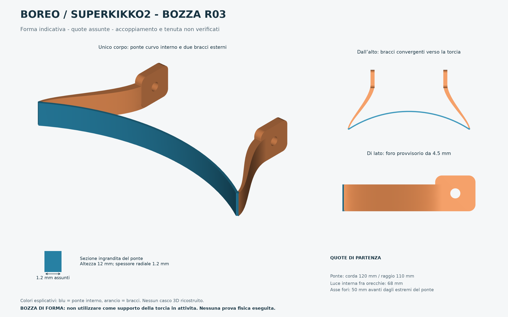

# BOREO / Superkikko2 — bozza R03

**Bozza di forma con quote assunte, preparata il 15 ottobre 2026.** Il modello serve a vedere l'idea e a correggerne le proporzioni prima del rilievo. Geometria esportata e verificata: pronta per l'importazione nello slicer come bozza. **Non pronta per la stampa come supporto funzionale della torcia.**

La [valutazione successiva di peso e temperatura](../verifiche/valutazione-termica-preliminare.md) e la [revisione meccanica](verifiche/revisione-meccanica-r03.md) non approvano i nominali della R03: la zona da 1,2 mm e il fissaggio diretto ai perni caldi richiedono ulteriori verifiche.



## Forma proposta

Un solo corpo sostituisce piastra e staffa metallica a U: ponte curvo sottile all'interno del casco, due bracci integrali destinati alle aperture anteriori esistenti, orecchie esterne con fori laterali coassiali. Non sono previsti elastici o nuovi fori nel casco. I colori delle anteprime distinguono le zone dello stesso pezzo e non indicano materiali separati.

La bozza non include un modello del casco né della lampada. Il passaggio dei bracci nelle feritoie, l'inseribilità dell'intera U, la posizione rispetto a testa e girotesta e la rotazione della torcia non sono ancora verificati. Lo spessore interno di 1,2 mm rappresenta l'intenzione di avere poco ingombro; la sua resistenza non è dimostrata.

## Quote della bozza — tutte assunte

| Elemento | Nominale |
| --- | --- |
| Ponte curvo, corda della linea mediana | 120 mm |
| Raggio della linea mediana | 110 mm |
| Freccia della linea mediana | 17,805 mm |
| Spessore radiale / altezza del ponte | 1,2 / 12 mm |
| Spessore dei bracci | Transizione da 1,2 a 4 mm |
| Luce tra le facce interne delle orecchie | 68 mm |
| Orecchia: spessore X × lunghezza Y × altezza Z | 4 × 18 × 16 mm |
| Fori lisci laterali | Ø 4,5 mm, asse X |
| Asse dei fori rispetto agli estremi del ponte | Y = 50 mm; Z = 8 mm |
| Ingombro STL verificato | 121,163 × 59,445 × 16 mm |
| Quantità / corpi stampabili | 1 / 1 |

Assi: **X** sinistra–destra; **Y** avanti; **Z** alto. Origine sul piano inferiore, al centro fra gli estremi del ponte. Gli estremi della linea mediana del ponte sono a X ±60, Y 0. La corda di 120 mm non è la lunghezza dell'arco. Il foro Ø 4,5 non identifica una vite o una filettatura della Superkikko2; i 68 mm non sono una misura rilevata sulla torcia.

Le quote modificabili sono in [parametri_assunti.json](sorgenti/parametri_assunti.json). Le misure effettive ancora mancanti restano separate nel [registro di rilievo](../sorgenti/misure-da-rilevare.json). Cambiando molto raggio, corda o posizione dei fori occorre adattare anche i punti di controllo dei bracci e ripetere i controlli.

## File

- [STL](stampa/BOZZA_R03_NON_USO.stl): un pezzo, millimetri, piano inferiore a Z≈0.
- [STEP](stampa/BOZZA_R03_NON_USO.step): un solido CAD modificabile; sorgente BREP incluso.
- [3MF geometrico](stampa/BOZZA_R03_GEOMETRIA.3mf): millimetri, un oggetto, centro dell'ingombro a X/Y 128/128. Contiene soltanto geometria e disposizione; nessun profilo macchina, materiale o percorso di stampa.
- [GLB](stampa/BOZZA_R03_NON_USO.glb): visualizzazione, unità glTF in metri; stessa geometria dello STL. La variante colorata nelle anteprime distingue ponte e bracci.
- [Generatore](sorgenti/genera_modello.py), parametri, anteprime e verificatore indipendente.

## Eventuale campione di forma

Per un primo campione puramente geometrico si può valutare PLA; non è una scelta convalidata per sostenere la torcia. PETG Pro resta una possibilità per uno sviluppo funzionale, dopo verifica del prodotto specifico, del calore della lampada e dei carichi. Non assegnare resistenza al pezzo sulla base di questo CAD.

Orientamento proposto: il file è già con base a Z0, ponte e bracci verticali per 12 mm, orecchie alte 16 mm. Il bordo di appoggio del ponte è stretto. Prima di stampare occorre usare un profilo **ELEGOO Centauri Carbon 2 Combo** con ugello, piano e filamento effettivi; controllare continuità delle pareti sottili, primo strato, eventuale brim e sommità dei fori orizzontali. Un brim può richiedere rifinitura delicata sul ponte. Nessun supporto è già definito.

Come soli valori iniziali per una prova di forma con eventuale ugello da 0,4 mm: strato 0,20 mm, 3 perimetri, riempimento 20%. Sono impostazioni proposte, non calibrate: le regioni sottili possono diventare interamente pareti e la larghezza di estrusione effettiva va controllata. Temperature, velocità e raffreddamento vanno presi dalla scheda del filamento e dal profilo compatibile. Non sono confermati ugello installato, superficie del piano o bobina di questo progetto.

Slicing, supporti, adesione, percorso completo, tempi e consumo non sono verificati. Non è fornito G-code e non è stata avviata alcuna stampa. Prima di un montaggio reale occorrerà adattare le quote, controllare la ferramenta laterale e l'impegno delle viti, senza forzare il casco o comprimere le schiume. La compatibilità protettiva dell'inserto con il casco resta da verificare con il produttore.

## Verifiche eseguite

Il [report indipendente](verifiche/verifica_indipendente.json) riapre i file finali senza importare il generatore: **25 controlli superati**.

- STL: un corpo chiuso/manifold, volume positivo, normali coerenti, nessuna faccia degenere o duplicata e nessuno spigolo con incidenza anomala.
- Screening di 41.639 coppie di triangoli non adiacenti: nessuna intersezione rilevata. Le coppie con vertici comuni sono escluse; non è una prova esaustiva di ogni possibile autointersezione.
- STEP: un solido valido; ingombri coerenti con STL, differenza di volume dello 0,01245% dovuta alla discretizzazione.
- Sezione centrale del ponte di 1,2 mm, luce di 68 mm e due fori Ø4,5 coassiali confermati rispetto ai nominali assunti. Non è stato verificato lo spessore minimo globale.
- 3MF: struttura ZIP/XML, unità, quantità e trasformazione controllate; geometria corrispondente allo STL. GLB corrispondente dopo conversione metri → millimetri.

Restano non eseguiti: accoppiamento reale, inserimento nei passaggi, comfort, interferenze con casco/torcia, serraggio, carichi, temperatura, slicing e prova fisica. Le anteprime mostrano la geometria esportata, senza simulare questi riscontri.

## Rigenerazione

Python 3 con le versioni indicate nei file requisiti:

```sh
python3 -m venv .venv
.venv/bin/pip install -r sorgenti/requisiti.txt -r sorgenti/requisiti-verifiche-anteprime.txt
.venv/bin/python sorgenti/genera_modello.py
.venv/bin/python sorgenti/verifica_esportazioni.py
.venv/bin/python sorgenti/crea_anteprime.py
```

La generazione delle anteprime aggiorna anche il frammento interattivo nella cartella `output/visualizzazioni/` del workspace. Dopo una modifica geometrica rigenerare tutti i derivati e ripetere il controllo visivo delle anteprime.
