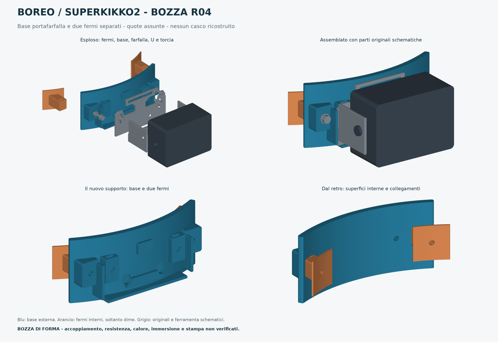

# BOREO / Superkikko2 — bozza R04 portafarfalla

**Modello di forma con quote assunte, 15 ottobre 2026.** Base esterna curva e due fermi interni separati; si conservano farfalla e U metallica originali. La precedente U diretta R03 è superata. Questa bozza serve a valutare la forma: **non è pronta per la stampa come supporto funzionale della torcia**.



## Componenti

- **Blu, base esterna:** sella curva con sedi per i terminali dei fermi, appoggi e battute della farfalla. Due fissaggi nelle asole laterali trattengono il metallo; i due centrali fra farfalla e U restano originali.
- **Arancio, due fermi:** introdotti separatamente dalle aperture; pattini interni sottili e arrotondati, chiusure accessibili dall'esterno. Sono **dime geometriche**, non fermi FDM portanti dimensionati. Per l'uso funzionale rimane aperto il confronto fra stampa e lamiera.
- **Grigio, riferimenti:** farfalla, U, torcia e ferramenta schematiche, soltanto per capire l'assemblaggio. Non sono scansioni, ricambi o componenti da fabbricare.

Non è presente un modello del casco. Lo spazio fra fermi e base non rappresenta uno spessore rilevato di calotta/schiuma. Il render non dimostra montabilità o vestibilità.

## Quote nominali — tutte assunte

| Elemento | Quota |
| --- | --- |
| Base, raggio interno / corda interna | 110 / 100 mm |
| Base, altezza / spessore radiale principale | 46 / 4 mm, oltre agli appoggi locali |
| Base, ingombro STL orientato | Circa 102,802 × 20,112 × 46 mm |
| Centri collegamenti fermi | X ±42 mm, Z 23 mm; assi Y |
| Pattino interno | Arco largo circa 24 mm, alto 24 mm, spessore radiale 1,2 mm **solo dima** |
| Ciascun fermo, ingombro STL orientato | Circa 21,943 × 24 × 22,927 mm |
| Gioco dei terminali nelle sedi | 0,35 mm per lato, 0,70 mm totale |
| Farfalla schematica | Ingombro nominale circa 70 × 41 × 1,5 mm |
| Fissaggi farfalla | X ±27 mm, Z 23 mm |
| Gioco sede farfalla | 0,4 mm per lato, 0,8 mm totale |
| Nuovi fori e ferramenta | Ø3,4 mm per ipotesi M3, da verificare |

Assi: X sinistra–destra, Y avanti verso la torcia, Z alto; centro di curvatura nominale XY=(0,−110). Gli ingombri esportati e le trasformazioni sono nel [manifest](sorgenti/manifest.json). Tutte le quote, comprese quelle di ferramenta e riferimenti, sono in [parametri_assunti.json](sorgenti/parametri_assunti.json); non sostituiscono misure reali.

## File

In `stampa/`: **una base e due fermi-dima**, STL in millimetri e STEP per ciascuno, più 3MF geometrico con disposizione dei tre pezzi. Nomi `NON_USO`/`DIMA` identificano la bozza. Il 3MF contiene unità e geometria, senza profili macchina, materiali o slicing. I riferimenti sotto `sorgenti/riferimenti-visuali/` sono esclusi dai piatti. L'assieme STEP/GLB serve alla consultazione e non va stampato come un unico oggetto.

## Montaggio rappresentato

1. Inserire i dadi nelle tasche dei terminali e della base prima dell'accoppiamento. Introdurre ogni fermo dall'interno della propria apertura e far emergere il terminale. La traiettoria reale è ancora da verificare con sagome, senza forzare il casco.
2. Posizionare da fuori la base sui terminali e chiudere i fissaggi contro le battute dei componenti. Non eliminare il gioco comprimendo la schiuma del casco.
3. Appoggiare farfalla e U originali sulla sede e trattenerle tramite le due asole laterali. Nel modello la torcia davanti limita l'accesso assiale: si prevede di smontare temporaneamente il corpo dalla U e rimontarlo dopo i fissaggi, mantenendo la ferramenta originale.
4. Verificare appoggi, accesso agli utensili, inclinazione, cavo, dissipatore, girotesta, imbottiture e testa. Non usare la bozza con la lampada in attività.

L'assenza di fori nuovi non dimostra la compatibilità protettiva. Il [manuale BOREO](https://www.petzl.com/on/demandware.static/-/Sites-petzl-master-catalog/default/dw79a6bf57/media/product/technical-notice-BOREO-2_068Tx000001zLa1IAE.pdf) limita accessori e modifiche: la soluzione richiede verifica degli appoggi e delle indicazioni del produttore.

## Eventuale campione di forma

PLA è una possibilità per un campione puramente geometrico, senza accendere o sostenere la torcia. PETG Pro non è ancora selezionato per l'uso finale. I fermi da 1,2 mm sono soltanto dime; forma e spessore non dimostrano resistenza. La farfalla può trasferire calore alla base. Servono prove anche per 5 °C, umidità 100% e immersione; durata, profondità e tipo di acqua sono ancora ignoti.

La base ha bordo inferiore a Z0; i fermi sono ruotati con la faccia anteriore del terminale sul piano. Questo orientamento riguarda il campione di forma: resistenza fra strati e supporti non sono convalidati. Controllare pattini sottili, primo strato, tasche e fori orizzontali nello slicer; brim e supporti devono poter essere rimossi senza danneggiare le dime.

Usare il profilo specifico **ELEGOO Centauri Carbon 2 Combo** con ugello, piano e bobina effettivi. Solo come ipotesi iniziale per un eventuale ugello 0,4 mm: strato 0,20 mm, 3 perimetri, riempimento 20%. Verificare continuità delle pareti sottili e larghezza d'estrusione. Temperature e velocità devono derivare dalla scheda della bobina e dal profilo compatibile. Questi dati di macchina/materiale non sono confermati per il progetto.

**Slicing non eseguito, nessun tempo/consumo stimato, nessun G-code o avvio di stampa.** Montaggio, comfort, resistenza, serraggio, calore e immersione non verificati.

## Verifiche e rigenerazione

**129 controlli geometrici superati sui file esportati.** I tre STL sono ciascuno un corpo chiuso/manifold, con normali coerenti e volume positivo, senza facce degeneri o duplicate e senza autointersezioni nello screening eseguito. Gli STEP riaperti sono validi; pose, fori nominali, spessore locale delle dime, assieme schematico e 3MF sono coerenti. I controlli delle interferenze riguardano soltanto le geometrie nominali modellate. Il 3MF contiene esattamente i tre pezzi nuovi, senza i riferimenti della torcia. L'anteprima interattiva è stata controllata anche a larghezza 320 px, nei diversi modi e temi, senza errori JavaScript/WebGL.

Il [report indipendente](verifiche/verifica_indipendente.json) documenta i controlli effettivi sui file riaperti. Il [report delle anteprime](verifiche/anteprime.json) registra geometrie e metodo di visualizzazione; le viste sono derivate dagli STL esportati, con VTK e WebGL. Ambiente usato: Python 3.11 e dipendenze nelle versioni indicate nei requisiti.

```sh
python3 -m venv .venv
.venv/bin/pip install -r sorgenti/requisiti.txt -r sorgenti/requisiti-verifiche-anteprime.txt
.venv/bin/python sorgenti/genera_modello.py
.venv/bin/python sorgenti/verifica_esportazioni.py
.venv/bin/python sorgenti/crea_anteprime.py
```

La vista interattiva viene scritta in `output/visualizzazioni/` del workspace. Dopo modifiche geometriche rigenerare tutti i derivati e ripetere verifiche e controllo visivo. Una mesh valida non dimostra resistenza o corretto montaggio sul casco.
