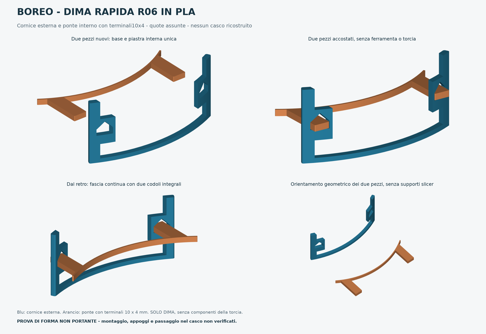

# BOREO — dima rapida R06 in PLA

**Pronto per la stampa della sola dima dimensionale**, 21 ottobre 2026. Due pezzi leggeri per controllare curvatura interna, ingresso dei terminali nelle feritoie e ingombro della base esterna. Nessuna ferramenta richiesta. Nessuna stampa fisica eseguita.



## File da usare

- [G-code per Centauri Carbon 2 Combo, ugello 0,4 mm, PEI testurizzato, ELEGOO PLA Basic](stampa/PLA_BASIC_ECC2/BOREO_R06_DIMA_PLA_BASIC_ECC2_04.gcode).
- [Progetto ElegooSlicer completo, con geometrie, profili e percorsi incorporati](stampa/PLA_BASIC_ECC2/BOREO_R06_DIMA_PLA_BASIC_ECC2_04.3mf).
- Gli STL/STEP separati e il 3MF solo geometrico restano in `stampa/`; non contengono i profili del lavoro completo.

Il G-code è stato generato da **ElegooSlicer 1.5.3.5** (motore CLI identificato come 2.4.2) e non è stato modificato a mano. Un piatto, una copia per pezzo, un solo filamento. Nessuna torre di spurgo o invio alla stampante.

## Stampa

Configurazione: **Centauri Carbon 2 Combo / ugello 0,4 mm / lato PEI testurizzato / ELEGOO PLA Basic**. Ugello e piano corrispondono alla configurazione già confermata e ai profili attuali; la bobina è stata confermata in questa chat.

| Impostazione | Valore salvato e verificato |
| --- | --- |
| Ugello / piano | 220 / 60 °C, preset PLA Basic ECC2 |
| Strato / primo strato | 0,28 / 0,20 mm |
| Pareti / riempimento | 2 / 15% gyroid |
| Strati superiori / inferiori | 2 / 2 |
| Brim esterno / distacco brim | 4 / 0,1 mm |
| Supporti / raft | Nessuno / nessuno |
| Velocità parete esterna / interna / riempimento | 50 / 80 / 100 mm/s |
| Primo strato | 25 mm/s |
| Portata massima | 12 mm³/s, limite prudente rispetto al preset |

**Stime effettive dello slicer: 28 min 21 s, 7,27 g, 165 strati**, brim e preparazione previsti dal profilo inclusi. La stampa fisica può differire dalle stime. Con il passo da 0,28 mm l'ultimo piano di estrusione è Z46,12; il ponte nominale da 4 mm termina a Z4,12: considerare circa 0,12 mm di discretizzazione verticale in questa prova rapida.

Prima di avviare: usare il lato testurizzato pulito, verificare che il PLA Basic sia alimentato e il piano libero; eseguire i controlli/calibrazioni ordinari della macchina. **Stampare con sportello anteriore aperto e/o vetro superiore rimosso**, come richiesto dall'avviso PLA dello slicer per evitare surriscaldamento in camera chiusa. L'avviso è conservato e documentato in [avviso_PLA_camera.json](verifiche/slicing/avviso_PLA_camera.json); le temperature e la soglia del materiale non sono state alterate per nasconderlo. I parametri di flusso e adesione non sono calibrati fisicamente su questa bobina.

Lasciare raffreddare, staccare i due pezzi e rimuovere delicatamente il brim. Non occorre togliere supporti. Non modificare la scala all'importazione: millimetri, 100%.

## Come fare la prova

1. A casco non indossato, presentare il ponte arancio dall'interno e provare a far passare i due terminali. Se un passaggio oppone resistenza, fermarsi e segnare dove: non forzare, tagliare o comprimere la schiuma.
2. Presentare da fuori la cornice blu sui terminali, senza viti e tenendola a mano. I passaggi della cornice hanno gioco nominale di 0,35 mm per lato; il tetto inclinato serve a stamparli senza supporti e non blocca il gioco verticale.
3. Controllare distanza reciproca dei terminali, lunghezza sporgente, aderenza della curva e posizione dei bordi della base. La cornice indica altezza e larghezza esterne, ma è aperta al centro e sopra: non verifica una sede completa della farfalla.
4. Annotare dove tocca, quanto manca o eccede e fotografare l'accostamento. Il risultato serve a correggere le quote della prossima versione.

## Quote della dima e limiti

Tutte le quote CAD restano **assunte**: raggio base 110 mm, corda interna 100 mm, altezza cornice 46 mm; ingombro STL circa **102,80 × 15,58 × 46 mm**. Ponte interno arcuato: raggio interno 90,8 mm, spessore radiale 1,2 mm, altezza 4 mm; ingombro con terminali circa **104,98 × 33,39 × 4 mm**. Interasse terminali 84 mm e terminali nominali **10 × 4 mm**: la sezione è ridotta rispetto ai 10 × 12 mm della R05 per una prova semplice del passaggio e non definisce il futuro pezzo resistente.

Il distacco radiale nominale è 18 mm, uno scenario da provare: non è una misura confermata fra gli appoggi reali. I 63 mm dichiarati dall'utente restano la distanza fra i bordi vicini delle feritoie e non sono stati usati come interasse. La dima riduce l'altezza interna per risparmiare tempo: prova una fascia locale della curva, non la vestibilità di un'intera piastra alta 24 mm. I riferimenti derivano dal [rilievo parziale](sorgenti/rilievi/2026-10-16-feritoie.json).

**Solo prova di ingombro: non montare la torcia sulla dima e non usarla in attività.** Nessuna verifica di resistenza, calore, immersione o compatibilità protettiva del casco è inclusa.

## Controlli e sorgenti

- [59 controlli sui file riaperti](verifiche/geometria.json): due solidi chiusi/manifold, normali e volumi validi, nessuna faccia degenere/duplicata o autointersezione nello screening; STEP, STL, assieme e 3MF riconciliati. Scarto massimo limite CAD/STL circa 0,0325 mm, entro la tolleranza di tessellazione dichiarata 0,06 mm.
- [Slicing e file consegnati](verifiche/slicing/report.json): tutti i 165 strati non vuoti e nei limiti del piano, nessuna isola sospesa candidata; percorsi e dettagli presenti nelle tavole sotto `anteprime/slicing/`, riviste visivamente. Aperture con tetto inclinato e piccoli ponti verificati nelle tavole; rimovibilità del brim e risultato reale ancora da provare.
- Il G-code esterno e quello incorporato nel 3MF sono identici. Non sono stati inviati alla macchina.

Sorgenti e parametri in `sorgenti/`, profili in `slicer/`. Per rigenerare, con Python 3.11 e i requisiti indicati:

```sh
python sorgenti/genera_dima.py
python sorgenti/verifica_dima.py
python sorgenti/prepara_slicing_pla.py
python sorgenti/crea_anteprime.py
```

Dopo una modifica geometrica rieseguire tutti i passaggi e la revisione dei percorsi. L'avvio della stampa rimane a cura dell'utente.
